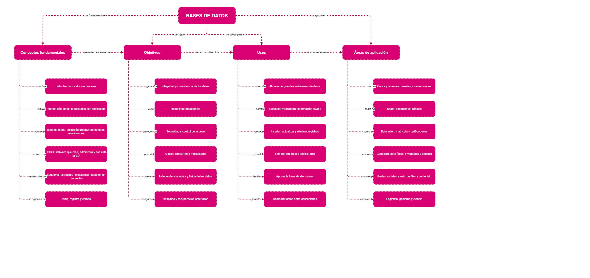

# Mapa conceptual: fundamentos, objetivos, usos y áreas de aplicación de las bases de datos

**Fuente vectorial:** [`MapaConceptual/Diagramabdd.svg`](MapaConceptual/Diagramabdd.svg)

## Estructura del mapa

El concepto central es **Bases de datos**, del que se desprenden cuatro ramas conectadas mediante frases de enlace:

| Rama | Frase de enlace | Contenido |
|---|---|---|
| Conceptos fundamentales | *se fundamenta en* | Dato, información, base de datos, SGBD, esquema e instancia, tabla/registro/campo |
| Objetivos | *persigue* | Integridad y consistencia, reducción de redundancia, seguridad, acceso concurrente, independencia de datos, respaldo y recuperación |
| Usos | *se utiliza para* | Almacenar, consultar, modificar, generar reportes, apoyar decisiones y compartir datos |
| Áreas de aplicación | *se aplica en* | Banca, salud, educación, comercio electrónico, redes sociales, logística, gobierno y ciencia |

## Relaciones entre ramas

Los **conceptos fundamentales** *permiten alcanzar los* **objetivos**, que *hacen posibles los* **usos**, los cuales *se concretan en* las **áreas de aplicación**.

## Referencias

Ver la sección de referencias en el [README](README.md).
