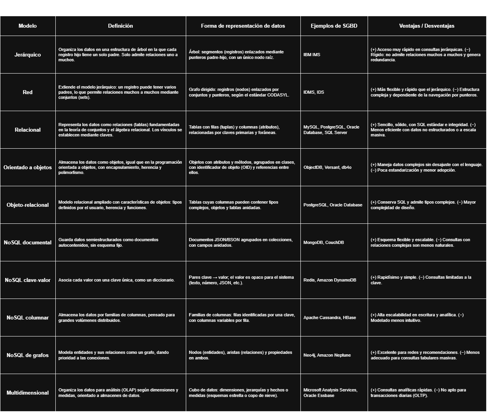

# Tabla comparativa de modelos de bases de datos

**Fuente vectorial:** [`TablaComparativa/TablaMDBDD.drawio.svg`](TablaComparativa/TablaMDBDD.drawio.svg)

## Versión en texto

| Modelo | Definición | Forma de representación de datos | Ejemplos de SGBD | Ventajas / Desventajas |
|---|---|---|---|---|
| Jerárquico | Organiza los datos en una estructura de árbol en la que cada registro hijo tiene un solo padre. Solo admite relaciones uno a muchos. | Árbol: segmentos (registros) enlazados mediante punteros padre-hijo, con un único nodo raíz. | IBM IMS | (+) Acceso muy rápido en consultas jerárquicas. (−) Rígido: no admite relaciones muchos a muchos y genera redundancia. |
| Red | Extiende el modelo jerárquico: un registro puede tener varios padres, lo que permite relaciones muchos a muchos mediante conjuntos (sets). | Grafo dirigido: registros (nodos) enlazados por conjuntos y punteros, según el estándar CODASYL. | IDMS, IDS | (+) Más flexible y rápido que el jerárquico. (−) Estructura compleja y dependiente de la navegación por punteros. |
| Relacional | Representa los datos como relaciones (tablas) fundamentadas en la teoría de conjuntos y el álgebra relacional. Los vínculos se establecen mediante claves. | Tablas con filas (tuplas) y columnas (atributos), relacionadas por claves primarias y foráneas. | MySQL, PostgreSQL, Oracle Database, SQL Server | (+) Sencillo, sólido, con SQL estándar e integridad. (−) Menos eficiente con datos no estructurados o a escala masiva. |
| Orientado a objetos | Almacena los datos como objetos, igual que en la programación orientada a objetos, con encapsulamiento, herencia y polimorfismo. | Objetos con atributos y métodos, agrupados en clases, con identificador de objeto (OID) y referencias entre ellos. | ObjectDB, Versant, db4o | (+) Maneja datos complejos sin desajuste con el lenguaje. (−) Poca estandarización y menor adopción. |
| Objeto-relacional | Modelo relacional ampliado con características de objetos: tipos definidos por el usuario, herencia y funciones. | Tablas cuyas columnas pueden contener tipos complejos, objetos y tablas anidadas. | PostgreSQL, Oracle Database | (+) Conserva SQL y admite tipos complejos. (−) Mayor complejidad de diseño. |
| NoSQL documental | Guarda datos semiestructurados como documentos autocontenidos, sin esquema fijo. | Documentos JSON/BSON agrupados en colecciones, con campos anidados. | MongoDB, CouchDB | (+) Esquema flexible y escalable. (−) Consultas con relaciones complejas son menos naturales. |
| NoSQL clave-valor | Asocia cada valor con una clave única, como un diccionario. | Pares clave → valor; el valor es opaco para el sistema (texto, número, JSON, etc.). | Redis, Amazon DynamoDB | (+) Rapidísimo y simple. (−) Consultas limitadas a la clave. |
| NoSQL columnar | Almacena los datos por familias de columnas, pensado para grandes volúmenes distribuidos. | Familias de columnas: filas identificadas por una clave, con columnas variables por fila. | Apache Cassandra, HBase | (+) Alta escalabilidad en escritura y analítica. (−) Modelado menos intuitivo. |
| NoSQL de grafos | Modela entidades y sus relaciones como un grafo, dando prioridad a las conexiones. | Nodos (entidades), aristas (relaciones) y propiedades en ambos. | Neo4j, Amazon Neptune | (+) Excelente para redes y recomendaciones. (−) Menos adecuado para consultas tabulares masivas. |
| Multidimensional | Organiza los datos para análisis (OLAP) según dimensiones y medidas, orientado a almacenes de datos. | Cubo de datos: dimensiones, jerarquías y hechos o medidas (esquemas estrella o copo de nieve). | Microsoft Analysis Services, Oracle Essbase | (+) Consultas analíticas rápidas. (−) No apto para transacciones diarias (OLTP). |
